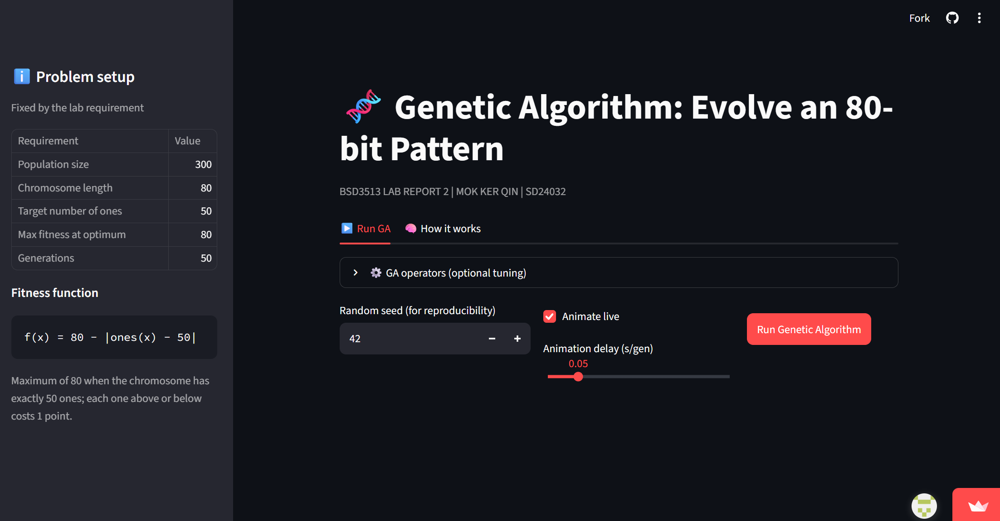
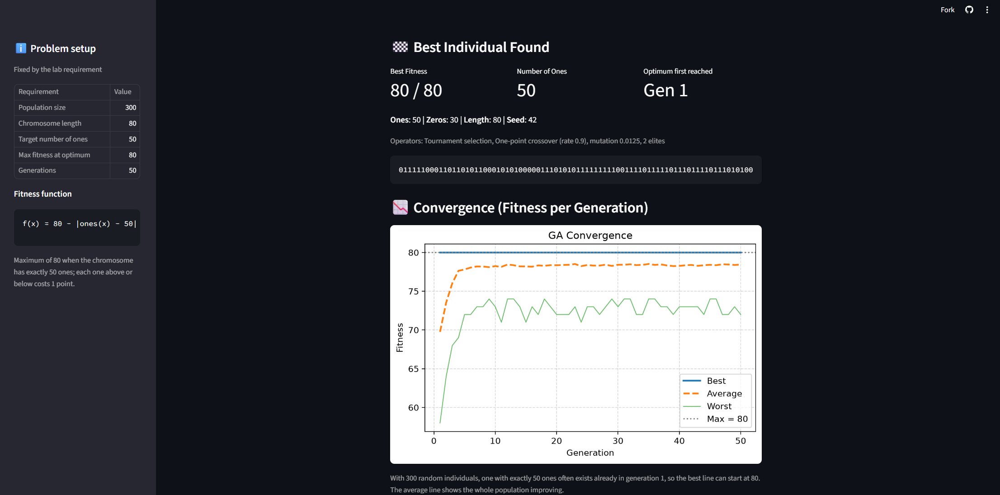
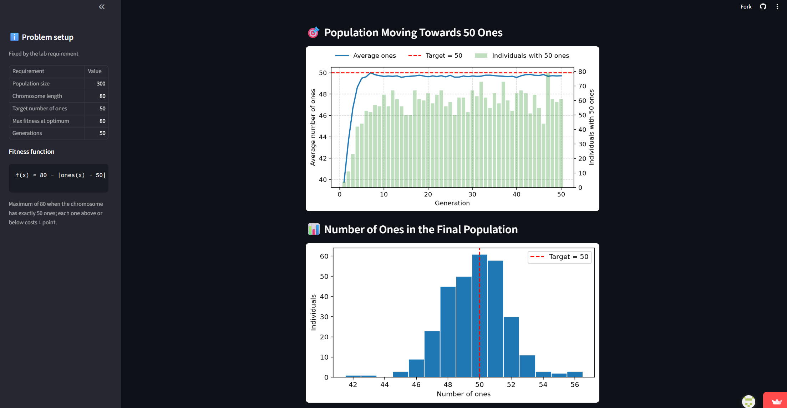
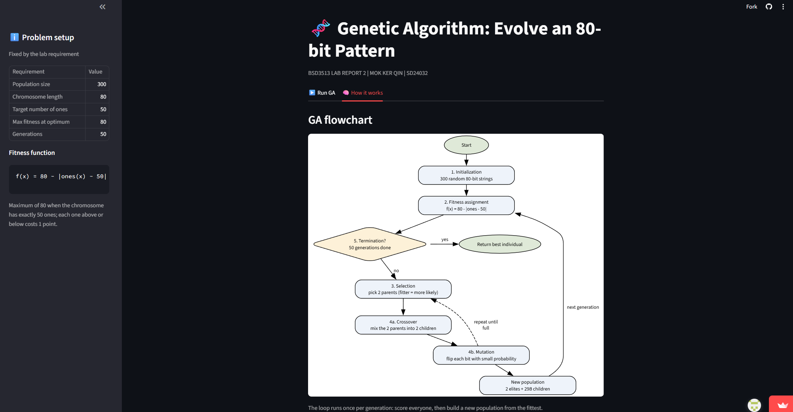
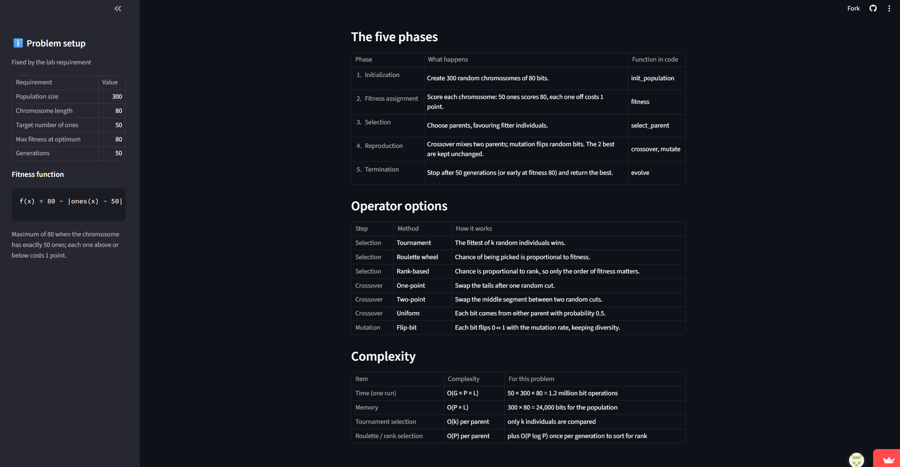

# 🧬 Genetic Algorithm: Evolve an 80-bit Pattern

BSD3513 Introduction to Artificial Intelligence, Lab Report 2 
**Mok Ker Qin | SD24032**

A Streamlit app that runs a genetic algorithm (GA) to evolve 80-bit chromosomes whose number of ones equals 50.

**Live app:** https://ailabreport2-bjpgapp9gz29alguqytxejr.streamlit.app/
**Repository:** https://github.com/mokkerqin-hub/AI_LabReport2

## Problem

| Requirement | Value |
|---|---|
| Population size | 300 |
| Chromosome length | 80 bits |
| Optimum | number of ones = 50 |
| Fitness at optimum | 80 |
| Generations | 50 |

Fitness function: `f(x) = 80 - |ones(x) - 50|`

## GA design

| Phase | Implementation |
|---|---|
| Initialization | 300 random 0/1 chromosomes |
| Fitness assignment | `f(x) = 80 - abs(ones - 50)` |
| Selection | Tournament (k = 3, default), roulette wheel or rank-based |
| Reproduction | One-point (default), two-point or uniform crossover (rate 0.9) + flip-bit mutation (rate 1/80 per bit), 2 elites kept |
| Termination | After 50 generations (optional early stop at fitness 80) |

## Screenshots

<table>
  <tr>
    <td colspan="2" align="center">
      <br>
      <b>Home page</b><br>Problem setup in the sidebar and the Run GA controls.
    </td>
  </tr>
  <tr>
    <td align="center" width="50%">
      <br>
      <b>Best individual and convergence</b><br>The best individual found and the fitness chart across generations.
    </td>
    <td align="center" width="50%">
      <br>
      <b>Population results</b><br>Average number of ones per generation and the final population distribution.
    </td>
  </tr>
  <tr>
    <td align="center" width="50%">
      <br>
      <b>GA flowchart</b><br>Flowchart of the genetic algorithm loop in the How it works tab.
    </td>
    <td align="center" width="50%">
      <br>
      <b>Phases, operators and complexity</b><br>Tables of the five GA phases, operator options and complexity.
    </td>
  </tr>
</table>

## Run locally
1. Download this repo (green **Code** button → **Download ZIP**) and unzip it.
2. Open a terminal in the folder and run:
```bash
pip install -r requirements.txt
streamlit run AI_Lab2.py
```

## Project structure
```
AI_Lab2.py           # Streamlit app
requirements.txt     # dependencies
screenshot/          # README images
```
